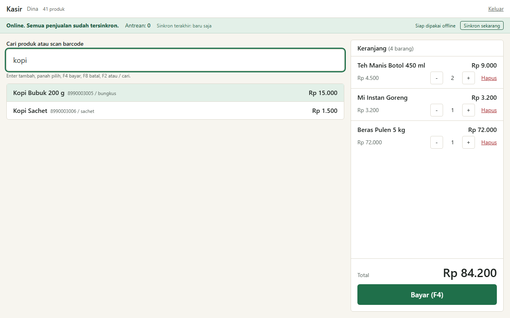
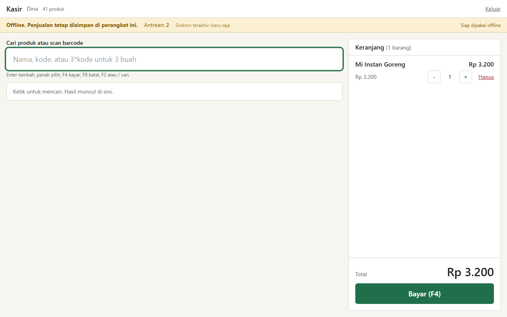
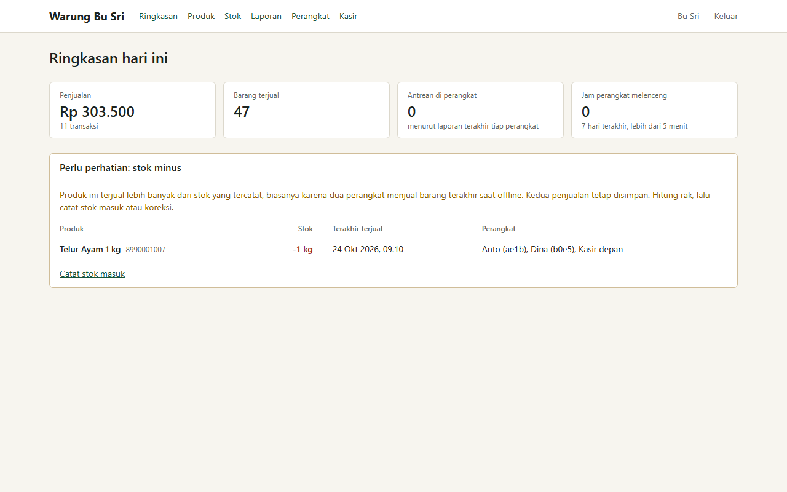
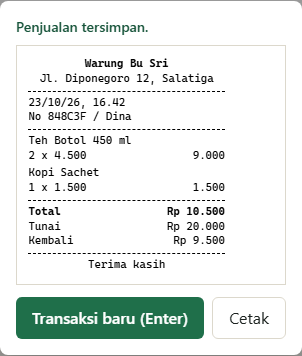
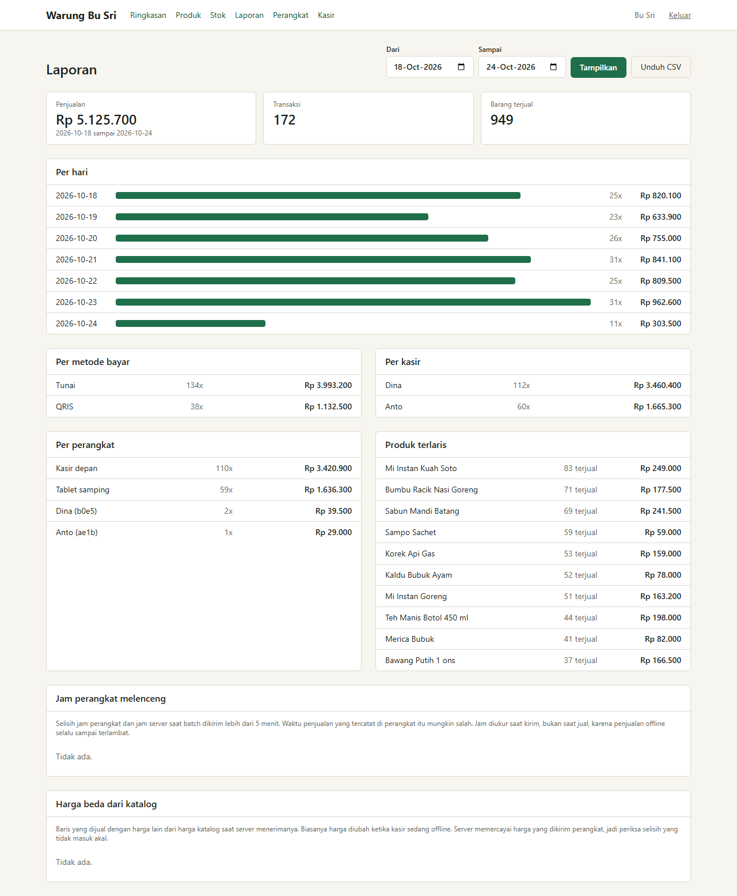

# warung-pos

[](https://github.com/ramaraihan12/warung-pos/actions/workflows/ci.yml)

A point of sale for a small shop (a warung) that keeps selling when the internet drops and syncs when it comes back. A cashier rings up sales from the keyboard, takes cash or a manual QRIS payment and prints a 58 mm receipt. The owner manages products, receives stock and reads reports. The shop in the demo, Warung Bu Sri in Salatiga, and all of its products and people are made up.



That is the till on my laptop, online. The banner shows the queue is empty. Below is the same till with the network switched off: the sale is already in the queue, nothing is lost, and the banner says so.



## How it works

- Once the till has loaded, it does not need the network. A small hand-written service worker (`public/sw.js`) caches the page and its hashed JS and CSS. The catalog lives in IndexedDB through Dexie. A sale is a single local write to an outbox table, with a UUIDv7 made on the device.
- The outbox flushes to `POST /api/sync` in batches of up to 100, oldest first. A failed batch backs off 1 s, 2 s, 4 s, up to 60 s, with jitter. The server inserts each sale with `ON CONFLICT DO NOTHING` on the sale id and returns an ack per sale, so a retry after a lost response cannot double count.
- The catalog comes down as deltas. Every product write takes the next number from one Postgres sequence, and a device asks for everything after its cursor. Deactivated products are sent as tombstones so the device can drop them.
- Stock is never a stored number. It is the sum of `stock_movements` (receiving positive, sales negative), computed on the server. A sale is never refused for lack of stock, because the customer already has the goods. If two offline devices sell the last egg tray, both sales are kept, stock reads -1, and the owner sees the product in an Attention list.
- Each browser registers a device id and reports its queue size after every sync attempt. The owner sees last sync time and pending count per device. The clock check compares the device clock with the server clock at the moment a batch is sent, not at the moment of sale, because an offline sale always arrives late and that gap says nothing about the clock. A gap over 5 minutes is flagged in the report.
- Money is integer rupiah everywhere (`integer` columns, no floats, a guard that throws on a fractional value). Reports bucket days in Asia/Jakarta time.



That is the result of the second e2e test: two cashiers sold the last unit while offline and both sales landed.

## Stack

TypeScript 5.9 (strict), Next.js 16.4 App Router with React 19.3, Tailwind 4.3, Drizzle ORM 0.45 on Postgres 17, Better Auth 1.7 (email and password, roles owner and cashier), Dexie 4.4, Zod 4.6, Vitest 5, Playwright 1.64 and pnpm 10 on Node 24.

## Run it

You need Node 24, pnpm and a Postgres 17 you can reach. The defaults in `.env.example` expect it on port 5433.

```bash
docker run -d --name warung-pos-db -e POSTGRES_PASSWORD=postgres -e POSTGRES_DB=warung_pos -p 127.0.0.1:5433:5432 postgres:17
docker exec warung-pos-db psql -U postgres -c "create database warung_pos_test"
cp .env.example .env              # then set BETTER_AUTH_SECRET (openssl rand -hex 32)
pnpm install
pnpm db:migrate
pnpm db:seed -- --history         # 41 made-up products, 3 users, a week of made-up sales
pnpm build && pnpm start          # the service worker only registers in a production build
```

Open http://localhost:3010. Seeded logins, all with the password `warung123`: `owner@warungbusri.test`, `kasir1@warungbusri.test`, `kasir2@warungbusri.test`. Cashiers land on the till, the owner on the overview. `pnpm dev` works too, but without the offline shell. More accounts: `pnpm user:add <email> <name> <owner|cashier> <password>`.

Till keys: type a name or scan a barcode and press Enter, `3*8990003003` adds three, arrows pick a result, F4 pays, F8 clears the cart, F2 or `/` jumps to the search box. In the payment dialog F1 is cash and F3 is QRIS.

| Variable             | Default                   |                                               |
| -------------------- | ------------------------- | --------------------------------------------- |
| `DATABASE_URL`       | local Postgres on 5433    | app database                                  |
| `TEST_DATABASE_URL`  | `warung_pos_test` on 5433 | integration and e2e tests, skipped when unset |
| `BETTER_AUTH_SECRET` | empty                     | signs sessions, required in Docker            |
| `BETTER_AUTH_URL`    | `http://localhost:3010`   | public URL of the app                         |
| `AUTH_RATE_LIMIT`    | on                        | set to `off` only for the e2e run             |

### Docker

```bash
echo "BETTER_AUTH_SECRET=$(openssl rand -hex 32)" >> .env
docker compose up -d --build
docker compose --profile seed run --rm seed
```

The image is `node:24-slim` with Next.js standalone output and runs as the `node` user. A one-off `migrate` service applies the SQL first. The app is published on `127.0.0.1:3010` only, and the database is not published at all.

## Offline caching

Serwist has a Turbopack package, but I did not try it. I wanted two things it would hide: the strategy per route, and caching the per-user `/pos` page without a build-time manifest. So `public/sw.js` is about 140 lines and says what it does at the top:

- `/_next/static/*`: cache first. File names carry a content hash, so a cached copy is never stale.
- `/pos` navigations: network first with a 4 second timeout, then the last good copy, stored only after a logged-in 200.
- `/` and `/login` with no network: answered with the cached `/pos`, so a reload at the till still lands on the till.
- API calls and everything else are not touched. Sync handles its own failures. Signing out clears the cached page.

The first visit is not yet controlled by the worker, so the page sends it the list of files it loaded, and the banner shows "Siap dipakai offline" once the worker confirms the shell is stored. Going offline before that point and reloading fails, and I hit exactly that while writing the benchmark.

## Tests

```bash
pnpm test        # 47 unit tests, plus 13 integration tests when TEST_DATABASE_URL is set
pnpm build && pnpm test:e2e
```

Unit tests cover cart math, change, outbox batching and backoff, the flush loop against an in-memory store and catalog delta merging. Integration tests run `/api/sync` logic, stock, catalog deltas and reports against a real Postgres and skip without `TEST_DATABASE_URL`. The e2e tests use Chromium with `context.setOffline(true)`, which I checked also blocks the service worker's own requests. They run against the production build and the test database, and cover: three offline sales, a reload while offline, sync after reconnecting and the owner's report; two devices selling the last unit; the print stylesheet; and an authorization spec that sends partial render requests to every owner page as a visitor and as a cashier and checks no data comes back. CI runs all of it with a Postgres service.

```text
$ pnpm test:e2e
Running 10 tests using 1 worker
(trimmed: one line per test)
  10 passed (22.1s)
```



## Numbers

Real runs on my laptop (Ryzen 9 5900HX, 16 GB, Windows 11), headless Chromium, the production build, Postgres 17 in Docker on the same machine. Other jobs were running on the laptop at the time, so treat the sync time as a rough figure.

| What                                                                                    | Result                                                                      |
| --------------------------------------------------------------------------------------- | --------------------------------------------------------------------------- |
| Sync 1,000 queued sales (3 lines each, 10 batches of 100) from reconnect to empty queue | 3.1 s median of 3 runs (3.10, 3.10, 3.15), 1,000 rows in Postgres each time |
| JavaScript the `/pos` route loads, gzip                                                 | 213 KB over 10 files (702 KB raw)                                           |

`pnpm bench:sync` and `pnpm measure:bundle` reproduce both. The bundle number includes the React and Next.js runtime, Dexie, Zod and the till itself.



## Notes

- I have only run this in Chromium, on Windows and in the Docker image. The service worker and IndexedDB paths on Safari and Firefox are untested, and I have not printed to a real thermal printer, only checked that the print stylesheet leaves the receipt at 58 mm.
- Accounts have no sign-up screen. The cashier id travels inside each sale, so a cashier could attribute a sale to a colleague. It is fine for a shop where everyone knows each other, not for fraud control.
- A sale keeps the price the device had when it was rung up. If the owner changes a price while a till is offline, that sale keeps the old one. The till does not show stock, only the owner pages do, and only as fresh as the last sync.
- Catalog versions come from a sequence, and two edits that commit in a different order than they took their numbers could make a device skip one until the row changes again. With one owner editing it is rare. Pulling with a small overlap would fix it.
- A sale the server rejects (unknown product, totals that do not add up) is parked in IndexedDB and counted in the banner. There is no screen to repair it yet. Browsers can also evict IndexedDB under storage pressure, and the till only asks them not to.
- QRIS is a label on a manual payment. There is no provider, no webhook and no check that the money arrived.
- Next: a screen for parked sales, stock count adjustments from the owner pages, and the Background Sync API where it exists.

## License

MIT
